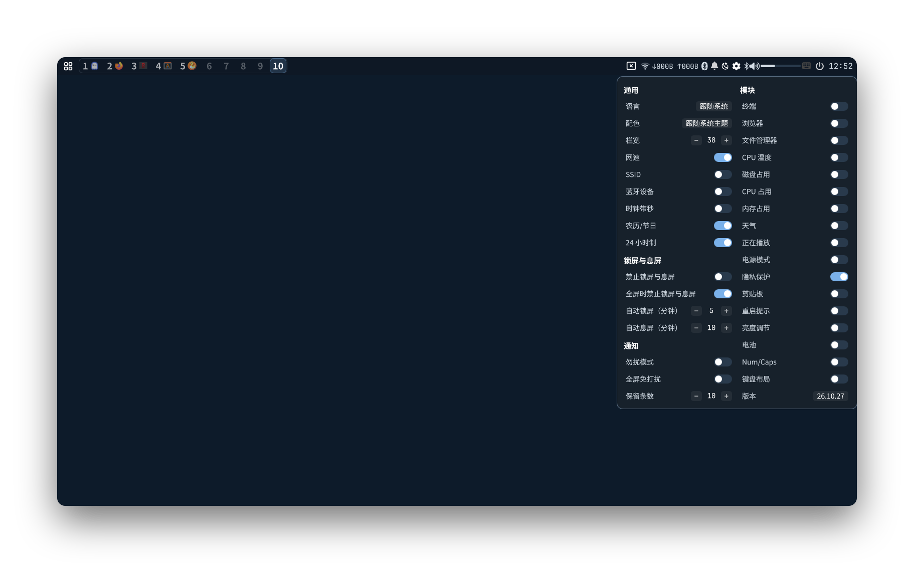

# TintedBar

[English](README.en.md) · [中文](README.md)

**A Quickshell desktop shell**: status bar, panels, lock screen, and wallpaper.



*Overall preview: status bar, settings panel, and desktop background.*

TintedBar is a Wayland desktop shell built with QML ([quickshell](https://quickshell.org)).
It replaces waybar + mako + wofi + wlogout + hyprpaper + hypridle + hyprlock +
hyprpolkitagent with a single process: the bar, panels (launcher / clipboard / power /
notifications / calendar / weather / settings), lock screen, and wallpaper all live there.
There is no persistent Python/Node process, and it uses the network only for weather.

- Targets Hyprland or niri (wlroots / smithay compositors with layer-shell + IPC).
- Panels are driven entirely through IPC and do not claim any keybindings; bind keys in your compositor.
- ⚠️ **Saving a `.qml` file hot-reloads the configuration. Do not save while the screen is locked or a
  polkit prompt is open**: reloading recreates windows (the screen goes black for a moment), and an
  authorization in progress will be cancelled.

## Highlights

- Window title and close button sit in the center of the bar, treating the bar as part of the window.
- Designed for small screens: one window per workspace, with real window icons on workspace buttons.
- Useful without bloat: complex features are out of scope; day-to-day setup is weather coordinates
  and wallpaper mappings.

## Requirements

**Required** (missing pieces prevent startup or break major features):

| Dependency | Purpose |
| --- | --- |
| quickshell 0.3.x, Qt 6.12 | Runtime |
| Hyprland or niri (`hyprctl` / `niri msg`) | Workspaces, titles, focus, DPMS |
| D-Bus session bus + NetworkManager / UPower / BlueZ / PipeWire / notification service | Network, battery, Bluetooth, volume, notifications; missing services leave the corresponding module empty without crashing |
| `sh` + coreutils (`grep`/`sed`/`find`/`df`) | Read `/proc`, `/sys`, and invoke CLI tools |
| Fonts **JetBrainsMono Nerd Font (v3+)** + **Noto Sans CJK SC** | Icon glyphs and Chinese. A missing preferred font emits a `[FONT]` warning; Nerd Font automatically selects another installed family, while Chinese uses the system font fallback. **Nerd Font v3 or newer is required**: brightness/weather/bluetooth-off glyphs use v3-remapped codepoints and break on v2 even when the family name matches. If no usable Nerd Font is installed, install one or change the preferred name in `Style.qml` |

**Optional, per module** (missing pieces only affect that module):

| Dependency | Effect |
| --- | --- |
| `cliphist` + wl-clipboard | Clipboard panel. **Add the writer to your compositor autostart**: `wl-paste --watch cliphist store` |
| `curl` | Weather (requests Open-Meteo every 30 minutes only while enabled) |
| `ddcutil` | External monitor brightness (DDC/CI; user must be in the `i2c` group). Built-in screen backlight goes through logind and needs no package |
| `gsettings` / `gio` (or `xdg-open`) | Follow system light/dark mode / open apps from the launcher |
| `notify-send` (libnotify) | Notification action for the reboot prompt; the icon remains clickable but shows no details without it |
| `systemctl` / `loginctl` | Power-menu shutdown / reboot / suspend / logout |
| `nm-applet` / `blueman-manager` / `pavucontrol` | Panels opened by the network / Bluetooth / volume icons |
| `$TERMINAL` (fallback `alacritty`) | Terminal button and `top` from temperature / disk / CPU / memory |

**No need to install**: playerctl / pactl / wpctl / brightnessctl / grim / jq / python / Node.
Media uses MPRIS (D-Bus), volume uses the PipeWire service, network speed comes from `/proc`, and
notifications are sent by TintedBar itself.

## Quick start

1. **Use it as quickshell's default configuration**: extract to `~/.config/quickshell/` (the entry point
   is `shell.qml`) and run `quickshell`. Any directory works: `quickshell -p <dir>`. To keep multiple
   copies, place each at `~/.config/quickshell/<name>/shell.qml` and select one with
   `quickshell -c <name>`.
2. **Start with your session**: add `quickshell` to your compositor's autostart. Use `quickshell -n`
   to exit immediately if an instance is already running.
3. **Debug in the foreground**: `quickshell --no-color`; add `-d` to detach it from the terminal.

```sh
# Hyprland (hyprland.conf)
exec-once = quickshell

# niri (config.kdl)
spawn-at-startup "quickshell"
```

Changes to `.qml` files hot-reload on save; no restart is needed. The log is at
`/run/user/$UID/quickshell/by-pid/<pid>/log.log` (use `ls -t` for the latest one). To remove
TintedBar, delete the autostart line and exit the process: it works only inside its own process,
does not install services, and does not modify system settings.

## Common IPC

Panels are controlled through IPC (`quickshell` can be shortened to `qs`); bind keys in your compositor,
for example to `Super+Space`:

```sh
qs ipc call launcher toggle           # launcher
qs ipc call clips toggle              # clipboard
qs ipc call powermenu toggle          # power menu
qs ipc call settings toggle           # settings panel
qs ipc call calendar toggle           # calendar
qs ipc call weather toggle            # weather
qs ipc call notify toggle             # notification history
qs ipc call lock toggle               # lock screen
qs ipc call wallpaper reload          # reload wallpaper mappings
qs ipc call bt toggle                 # toggle Bluetooth power
qs ipc call audio mute                # mute/unmute the default output
qs ipc call net toggle                # disconnect/reconnect the current link (wired first)
qs ipc call brightness set <0-100>    # brightness (also supports step <±N>)
```

With multiple monitors, panels open on the **focused screen**; lock / wallpaper / bt are global.
See the [full command reference](docs/reference.md#ipc键位自行绑定) for tray menus and per-cell
network control (currently in Chinese).

## Bar actions

| Area | Left click | Right click |
| --- | --- | --- |
| Terminal / workspace | Open terminal / switch workspace | — |
| Clock / bell | Calendar / notification history | Switch calendar view / Do Not Disturb |
| Network | Open nm-applet | Toggle Wi-Fi radio; disconnect or reconnect the Ethernet link; disconnect the current link from the speed readout |
| Bluetooth | Open blueman-manager | Toggle Bluetooth power |
| Volume | Open pavucontrol | Mute/unmute the default output |
| Now playing (opt-in) | Play / pause (wheel = next / previous track) | Next track |
| Microphone (shown while in use) | Open the input-volume slider | Toggle mic mute (icon turns crossed-out and dims) |
| Brightness | Open the brightness slider | — |
| Light/dark / temperature etc. | Toggle system light/dark mode / open `top` in a terminal | — |
| Idle inhibitor | Toggle “inhibit now” | Lock immediately |
| Gear / reboot prompt | Settings panel / show reboot reasons | — / re-check immediately |

See [status icon details](docs/reference.md#状态图标细节) for the full state rules for Bluetooth,
network, privacy indicators, and the reboot prompt (currently in Chinese).

## Configuration

- `weather.conf`: weather coordinates as `lat=` / `lon=`; leave empty to hide the weather module.
- `wallpapers.conf`: one `output=image-path` or `output=#RRGGBB` per line. Images may live anywhere;
  use an absolute path or one starting with `~`. `*` is the fallback.
- `components/Style.qml`: font names, default bar height, panel corner radii, etc. Colors follow the
  current GTK theme by default.
- Settings toggles are stored in `~/.local/state/quickshell/bar-settings.json`; the program writes this
  file, so do not edit it by hand.

See the [full reference](docs/reference.md) for all fields, color families, and keyboard controls
(currently in Chinese).

## More documentation

- [Full reference](docs/reference.md) (Chinese): all IPC commands, keyboard controls, bar interactions,
  status icons, settings, and configuration files.
- [Advanced and troubleshooting](docs/advanced.md) (Chinese): lock screen, polkit, porting, version
  signatures, common problems, and directory layout.

## Credits

- Built on [Quickshell](https://quickshell.org) (LGPL-3.0-only). This repository contains configuration;
  it does not include Quickshell source code.
- The lunar conversion table and logic in `components/Lunar.qml` are adapted from
  [jjonline/calendar.js](https://github.com/jjonline/calendar.js) by JeaYang, licensed GPL-3.0-or-later.
- Power-menu icons come from Google Material Symbols Rounded (Apache-2.0).
- The initial layout and visual values were ported from the project's previous Waybar configuration.
  Waybar itself is MIT-licensed.
- Fonts and Qt are runtime dependencies and are not bundled with this repository.

See [THIRD_PARTY_NOTICES.md](THIRD_PARTY_NOTICES.md) for upstream sources, license texts, and the
font/Qt notes.

## License

Copyright (C) 2026 wrisky-cmyk

The original code in this project is licensed under the GNU General Public License v3.0
(GPL-3.0-only); third-party components remain under their respective licenses. See
[THIRD_PARTY_NOTICES.md](THIRD_PARTY_NOTICES.md) and [LICENSE](LICENSE) for details.

Power-menu icons come from Google Material Symbols Rounded and are licensed under Apache-2.0.
See [THIRD_PARTY_NOTICES.md](THIRD_PARTY_NOTICES.md) for sources, mappings, and the original SVGs.
